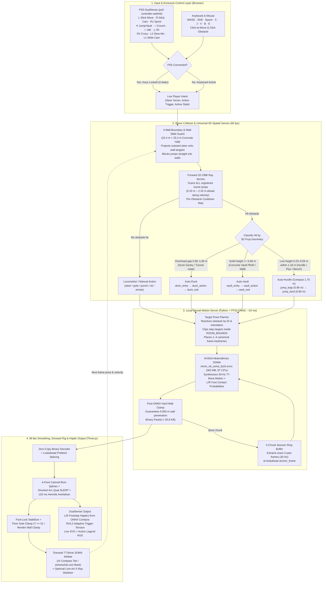

# SOMA Motion Lab — How It Works (Full System Architecture)

This guide explains how **Controls**, **4-Wall Room Collision**, the **Universal 3D OBB Spatial Sensor**, **NVIDIA MotionBricks SOMA (`mmm_v6_soma_fp16.onnx`)**, and **60 fps Smoothing & Haptics** connect together into one real-time interactive loop.

---

## 1. Complete System Architecture Diagram

---

## 2. How NVIDIA MotionBricks SOMA Generates Motion
- **Zero vision inside the neural network:** MotionBricks (`mmm_v6_soma_fp16.onnx`) is purely a **pose-to-pose generative neural model** — it never sees camera pixels or 3D meshes.
- **Exact inputs on every call (`POST /api/generate_bin`):**
  1. **Context (4 past frames at 30 Hz):** All 77 joint poses from the last ~133 ms (posture, stride phase, momentum).
  2. **Target (1–4 future keyframes):** A canonical motion snippet (Walk, Sprint, Vault, Hurdle, Duck, Sit, Punch, Emote) placed at the planned world `(x, z)` and heading.
- **Output (`~23–28 ms` on Apple Silicon CPU, 8 threads):** A smooth, physically grounded 30 Hz chunk (`20–56` frames) plus neural **foot-contact probabilities** (`L/R heel & toe`).

---

## 3. How Obstacle Detection & Compact Hurdling Work
- Every prop in the studio registers its 3D bounding geometry (`position`, `size [w, h, d]`, `rotation`, and optional `clearance`).
- **Universal Forward-Ray OBB Sensor (`web/src/main.ts`):** Casts a lookahead ray along the character's movement vector into every prop's rotated bounding box and classifies purely by geometry:

| Measured 3D Geometry | Prop Examples | Trigger Distance | Auto-Triggered MotionBricks Action |
| :--- | :--- | :--- | :--- |
| Overhead gap `0.90–1.65 m` | Duck Gantry, Low Tunnel Gate | `<= 2.25 m` | **Neural Duck** (`duck_entry → action → exit`) |
| Solid height `>= 0.60 m` | Vault Plinth, Gauntlet Vault Wall | `<= 2.25 m` | **Neural Hand-Vault** (`vault_entry → action → exit`) |
| Solid height `0.25–0.59 m` | Low Steel Hurdle, Plyo Block, Bench | `<= 1.18 m` | **Compact Neural Hurdle** (`0.90 m` leap + `0.80 m` land = `1.70 m`) |

- **Per-Obstacle Cooldowns:** Triggering one prop only cools down *that specific prop ID*, allowing continuous back-to-back chaining across tightly spaced props (`2.3 m` spacing in the rear Stress-Test Gauntlet) without skipping the next obstacle.
- **3-Layer Solid 4-Wall Collision:** Frontend wall-slide projection + backend ray-clipped targets + post-ONNX hard frame clamping guarantee the character slides smoothly along walls and can never run or jump outside the `15.4 m × 25.3 m` concrete hall.

---

## 4. PS5 DualSense Controls & Strict Exclusive Lockout
- Powered by [`ps5-controller-webhid`](https://www.npmjs.com/package/ps5-controller-webhid) over USB or Bluetooth (with standard Gamepad fallback).
- Connecting a PS5 controller immediately engages **Strict PS5 Exclusive Mode (`PS5 EXCLUSIVE · KEYS LOCKED`)**, blocking 100% of keyboard & floor-click input until disconnected:
  - `L-Stick`: 360° Move | `R-Stick`: Orbit Camera | `R1` / `L3`: Hold Sprint
  - `✕`: Jump / Vault | `○`: Crouch | `□`: Left Jab Combo | `△`: Sit / Stand on Bench
  - `R2`: Heavy Right Cross (adaptive resistance) | `L2`: Hold `0.25×` Slow-Mo | `L1`: Wide / Center Camera
  - `D-Pad ←/→`: Cycle 10 Styles | `D-Pad ↓`: Overhead Duck | `D-Pad ↑`: Emotes (`Scan` / `Stretch`)
  - `Touchpad`: Line-Art Neural X-Ray | `Options`: AI Guides | `Create`: Reset
